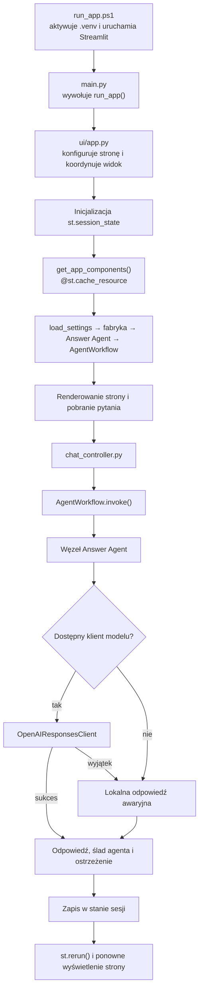

# Architektura aplikacji — notatki dla studentów

Ten dokument prowadzi od uruchomienia aplikacji do odpowiedzi Answer Agenta. Opisuje aktualny kod projektu i wyjaśnia, dlaczego poszczególne elementy są oddzielone.

## 1. Obraz całości

Aplikacja ma jeden aktywny Answer Agent. Streamlit odpowiada za interfejs i stan rozmowy, LangGraph za przekazanie zapytania do agenta, a adapter usługi za mapowanie wiadomości na format OpenAI Responses API.



## 2. Uruchomienie aplikacji

- [run_app.ps1](../run_app.ps1) aktywuje środowisko `.venv` i uruchamia `streamlit run main.py`. Domyślny port to `8501`, a serwer nasłuchuje na `127.0.0.1`.
- [main.py](../main.py) jest punktem wejścia. Jego zadaniem jest wywołać `run_app()` z pakietu UI.
- [job_assistant/ui/app.py](../job_assistant/ui/app.py) konfiguruje stronę, nakłada style, inicjalizuje sesję, pobiera współdzielone obiekty i koordynuje renderowanie.

`st.set_page_config()` jest wywoływane jako pierwsza operacja Streamlit, bo konfiguracja strony musi poprzedzać renderowanie elementów interfejsu. Ustawienia strony — tytuł, ikona i układ — pozostają takie jak dotychczas.

## 3. Konfiguracja i tworzenie zależności

| Plik | Odpowiedzialność |
| --- | --- |
| [job_assistant/app_settings.py](../job_assistant/app_settings.py) | Wczytuje `.env` i zmienne środowiskowe. Zwraca `AppSettings`; klucz API i adres bazowy są opcjonalne. Zmienne systemowe mają pierwszeństwo dzięki `override=False`. |
| [job_assistant/agents/agent_config.py](../job_assistant/agents/agent_config.py) | Przechowuje domyślne parametry modelu i limit kontekstu w niemutowalnym `AgentConfig`. |
| [job_assistant/agents/factory.py](../job_assistant/agents/factory.py) | Tworzy klienta modelu i agenta. Umożliwia też wstrzyknięcie ustawień lub klienta w testach. |
| [job_assistant/agents/answer_agent.py](../job_assistant/agents/answer_agent.py) | Składa Answer Agenta z fabryki, instrukcji, przykładów i lokalnej odpowiedzi awaryjnej. |
| [job_assistant/ui/app.py](../job_assistant/ui/app.py) | Zawiera `get_app_components()` oznaczone przez `@st.cache_resource`. |

Domyślna konfiguracja agenta to model `gpt-6-luna`, temperatura `0`, `max_output_tokens=2000`, `context_tokens=8000` i `reasoning_effort="none"`. Nazwę modelu można zmienić przez `OPENAI_MODEL`.

`get_app_components()` tworzy ustawienia, fabrykę, agenta i workflow. Cache zapobiega ponownemu tworzeniu tych współdzielonych zasobów przy każdym wykonaniu skryptu Streamlit. `st.cache_resource` jest współdzielone między sesjami; historia konwersacji nie jest tam przechowywana.

## 4. Answer Agent: instrukcja, kontekst i odpowiedź

### Instrukcja systemowa i przykłady

[job_assistant/agents/prompts.py](../job_assistant/agents/prompts.py) zawiera:

- `ANSWER_AGENT_PROMPT` — główną instrukcję systemową. Określa zakres odpowiedzi agenta i zasady pracy z pytaniami o rynek pracy.
- `ANSWER_AGENT_EXAMPLES` — siedem par przykładowych wiadomości użytkownika i agenta, które pokazują oczekiwany zakres oraz styl odpowiedzi.

Instrukcja i przykłady są przekazywane do agenta przy jego tworzeniu. Dzięki temu interfejs nie musi znać treści ani składać promptu.

Instrukcja zaznacza też ograniczenie aktualnej wersji: agent nie ma narzędzia do bieżącego wyszukiwania ofert i nie powinien twierdzić, że zweryfikował aktualne ogłoszenie. Graf nie zawiera osobnego węzła wyszukiwania.

### Budowanie wiadomości i kontrola kontekstu

[job_assistant/agents/base.py](../job_assistant/agents/base.py) zawiera główne elementy wykonania agenta:

- `Agent` składa wiadomości modelu w kolejności: instrukcja systemowa, przykłady, wcześniejsza historia i bieżące pytanie.
- `ContextManager` odrzuca nieobsługiwane role i puste treści, ogranicza liczbę wiadomości historii oraz pilnuje budżetu kontekstu.
- Liczba tokenów jest szacowana na podstawie długości tekstu, aby kontrolować limit bez dodatkowego tokenizera.
- Przy przekroczeniu budżetu zachowywane są instrukcja i bieżące pytanie w miarę dostępnego miejsca; najstarsza historia jest przycinana jako pierwsza.
- `OutputParser` pilnuje, by wynik był tekstem, i usuwa białe znaki z jego brzegów.
- `AgentRunResult` przenosi odpowiedź oraz opcjonalne ostrzeżenie o błędzie modelu.

Gdy klienta modelu nie ma, agent zwraca odpowiedź awaryjną. Gdy wywołanie modelu kończy się błędem, agent zapisuje wyjątek w logu, zwraca odpowiedź awaryjną i dołącza ostrzeżenie.

## 5. Adapter OpenAI

[job_assistant/services/llm_client.py](../job_assistant/services/llm_client.py) zawiera `OpenAIResponsesClient`. Adapter oddziela format żądania OpenAI od logiki agenta:

- pierwsza wiadomość systemowa trafia do pola `instructions`;
- pozostałe wiadomości — wcześniejsza historia i aktualne pytanie — trafiają do pola `input`;
- przekazywane są nazwa modelu, limit tokenów i ustawienia rozumowania;
- `temperature` jest przekazywane przy `reasoning_effort="none"`;
- `store=False` wyłącza przechowywanie żądania po stronie API;
- pusty lub nietekstowy wynik jest odrzucany, aby agent mógł zastosować swoją obsługę błędu.

## 6. Workflow

[job_assistant/workflows/graph.py](../job_assistant/workflows/graph.py) definiuje `AgentWorkflow` i stan `WorkflowState`. Aktualny graf ma jedną ścieżkę: `START → answer → END`. Węzeł `answer` wywołuje `Agent.run()` i zwraca:

- `answer` — tekst odpowiedzi;
- `agent_trace` — nazwa użytego agenta;
- `warnings` — lista ostrzeżeń, zwykle pusta.

`invoke()` przekazuje kopię historii, aby workflow nie modyfikował listy należącej do interfejsu. Pliki [diagram.py](../job_assistant/workflows/diagram.py) i [export_graph.py](../job_assistant/workflows/export_graph.py) służą do eksportowania grafu do PNG i Mermaid; nie są częścią obsługi wiadomości w Streamlit.

## 7. Interfejs Streamlit i stan rozmowy

| Plik | Odpowiedzialność |
| --- | --- |
| [ui/app.py](../job_assistant/ui/app.py) | Koordynuje uruchomienie, cache, renderowanie i obsługę nowego pytania. |
| [ui/styles.py](../job_assistant/ui/styles.py) | Zawiera CSS i funkcję `apply_styles()`. |
| [ui/components.py](../job_assistant/ui/components.py) | Renderuje sekcję wprowadzającą, ostrzeżenie konfiguracji, kartę powitalną i wiadomości. |
| [ui/session_state.py](../job_assistant/ui/session_state.py) | Definiuje typ `ChatMessage` oraz inicjalizację i odczyt historii sesji. |
| [ui/chat_controller.py](../job_assistant/ui/chat_controller.py) | Łączy pytanie, historię, workflow, odpowiedź, ostrzeżenie i obsługę błędów. |

`st.cache_resource` i `st.session_state` pełnią różne role:

- `st.cache_resource` przechowuje współdzielone zasoby — ustawienia i workflow z agentem.
- `st.session_state.chat_messages` przechowuje historię konkretnej sesji użytkownika i zachowuje ją po ponownym wykonaniu skryptu.

Typ wiadomości wymaga pól `role` i `content`; `agent_trace` i `warning` są opcjonalne. Wiadomość użytkownika zawiera tylko `role` i `content`. Odpowiedź agenta zawiera także ślad i ostrzeżenie, a komunikat błędu zawiera `role` i `content`.

## 8. Co dzieje się po wysłaniu pytania

W [chat_controller.py](../job_assistant/ui/chat_controller.py) kolejność operacji jest celowa:

1. Kontroler kopiuje dotychczasową historię.
2. Dopisuje bieżące pytanie do `st.session_state.chat_messages`.
3. Wywołuje `workflow.invoke(query=prompt, history=previous_history)`.
4. Zapisuje odpowiedź, ślad agenta i pierwsze ostrzeżenie, jeśli występuje.
5. Przy wyjątku zapisuje komunikat dla użytkownika i loguje szczegóły przez `LOGGER.exception`.
6. `st.rerun()` ponownie renderuje stronę z aktualną historią.

Bieżące pytanie nie znajduje się w `previous_history`, ponieważ jest przekazywane osobno jako `query`. Agent dopisuje je jako ostatnią wiadomość. Gdyby kontroler dołączył je także do historii, agent dostałby pytanie podwójnie.

## 9. Testy

Testy w katalogu `tests/` używają `unittest` i atrap, więc nie wykonują prawdziwych zapytań do OpenAI:

- `test_agents.py` — składanie kontekstu, granice promptu i odpowiedź awaryjna;
- `test_factory.py` — konfiguracja oraz mapowanie parametrów na żądanie API;
- `test_workflow.py` — przekazanie pytania i wcześniejszej historii do agenta;
- `test_chat_controller.py` — odpowiedź, brak pola `answer`, ostrzeżenia i wyjątek workflow;
- `test_diagram_export.py` i `test_export_graph.py` — zapis diagramów i obsługa błędów eksportu.

Uruchomienie testów z aktywnym `.venv`:

```powershell
python -m unittest discover -s tests
```

## 10. Krótka opowieść do przedstawienia na zajęciach

> `main.py` tylko uruchamia aplikację. Streamlit przygotowuje widok i zachowuje historię w stanie sesji. Fabryka składa Answer Agenta z instrukcją i przykładami. LangGraph przekazuje mu pytanie, a agent łączy je z wcześniejszą historią i pilnuje budżetu kontekstu. Adapter wysyła wiadomości do OpenAI, jeśli klient jest skonfigurowany; w przeciwnym razie agent zwraca odpowiedź awaryjną. Kontroler zapisuje wynik, po czym Streamlit ponownie wyświetla stronę.
